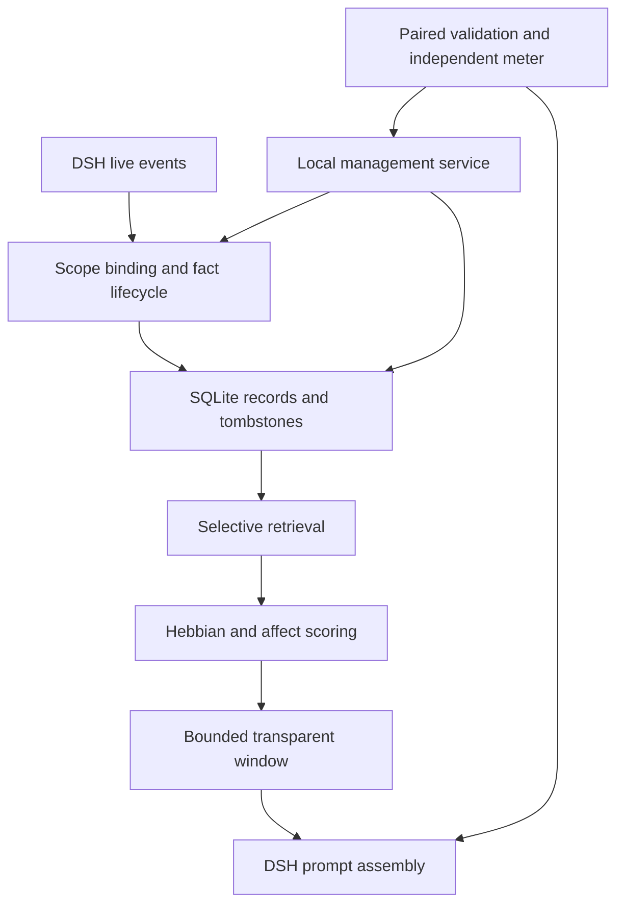

# REMI 整体框架与本地继续开发

本分支在原 `v0.3.0-alpha.1` 上继续实现，仍是 DeepSeek Harness 插件。保留透明窗口、有界 Hebbian 图、affect 和宿主原生压缩事务；新增作用域与事实管理，再用统一评测检验。它是可构建、可测试的开发框架，不是已验证可生产发布的 v0.4。

## 模块与调用关系



| 目录 | 职责 | 已有入口 |
|---|---|---|
| `packages/core` | 与 DSH 解耦的检索、生命周期类型、Hebbian/affect 评分、预算和 deterministic compaction | `SelectiveMemoryRuntime` |
| `packages/store-sqlite` | schema v4、不可变作用域、原子更正/删除、session/project 图、精确正文 tombstone | `SqliteMemoryStore` |
| `packages/dsh-adapter` | DSH 事件观察、配置、窗口装配、affect 模型路由、原生压缩适配 | `DshSelectiveMemory` |
| `packages/manager` | 本地人工管理、read-only recall 预览、导出、重复提议 | `MemoryManager`、`remi-memory` CLI |
| `packages/benchmark` | 原检索回放 + 五组真实模型验证计划、meter、本地 driver、质量和成本 gate | `validation-cli`、`run-paired-validation.mjs` |

正常完整模式的 `hebbianEnabled: true`、`affectEnabled: true`。情绪评分使用低权重检索提示；`emotionAnalysisEnabled` 另行控制是否花额外模型调用分析 query，默认沿用 `false`。测试用的 `no_hebbian` / `no_affect` 永远不是推荐默认配置。

## 先运行离线框架

在本地新分支或独立 checkout 中保留自己的未提交更改，不要覆盖本机主目录：

```powershell
pnpm install --frozen-lockfile
pnpm validate:offline
pnpm benchmark:affect
```

Node 要求沿用原项目：`^22.19.0 || >=24.0.0`，本次实际环境为 Node 24.19.0。Windows/Linux CI 使用 Node 24，只有实际 CI 结束后才能报告平台通过。

本地管理 demo：

```powershell
New-Item -ItemType Directory -Force C:/remi-validation | Out-Null
Get-Content examples/validation/manager-write.json -Raw | node packages/manager/dist/cli.js --db C:/remi-validation/demo.sqlite --create --write
Get-Content examples/validation/manager-recall.json -Raw | node packages/manager/dist/cli.js --db C:/remi-validation/demo.sqlite
```

预期写入输出 `{"inserted":true}`，召回正文包含 8247，trace 有 `selected`。重复相同写入应为 `false`。完整管理请求见 `packages/manager/README.md`。

## 再验证本机 DSH

不要立即替换原本机记忆库。先停宿主并备份一致的 SQLite 数据，再给测试 preset 使用独立 sidecar；schema v4 会迁移旧图命名空间。回滚旧代码应恢复备份，不能假定旧版本理解新图键。

沿用 `examples/deepseek-harness/cordis.yml` 的隔离 compaction group；入口仍为 `file:///C:/.../packages/dsh-adapter/dist/index.js`。`examples/validation/project-scope.patch.yml` 展示新增字段，但 group 内的 overlay 位置要与本机 preset 对应，不要同时注册两个 compaction provider。

新增配置：

| 字段 | 默认值 | 语义 |
|---|---|---|
| `affectEnabled` | `true` | 启用 affect 提取/评分；`false` 仅作专门消融或用户明确选择 |
| `projectRecallEnabled` | `false` | 显式开启同 owner/project 跨 session 候选与共享关联图 |
| `scopeOwnerId` | 空 | 由受信宿主填写，不由聊天/模型推测 |
| `scopeProjectId` | 空 | 同上；开启 project recall 时两个 ID 必须非空 |

绑定一旦建立不能把原 session 换到另一 owner/project；需新建 session。默认 session 检索保持原有作用域。项目检索同时使用项目图；原 session 图保留在独立 namespace，不会自动将它们并入项目图，避免把不明来源的历史边当作授权项目边。图上限分别作用于当前 graph namespace。

scope 是本地隔离机制，不是 multi-user 身份认证。开 project recall 后，对不同项目使用不同配置与 scope ID；同一个固定 preset 的 scope 不会自动跟着 cwd 改变。

## 成本与核心能力的五组实验

先给同一模型建立 5 个隔离测试 preset；全部保持相同 provider/model、temperature、maxTokens、DSH 版本和受控压缩时机。所有组都装独立 `remi-validation-meter`，包括无 REMI 的 baseline。配置例见 `examples/validation/meter.patch.yml`。

| 组 | REMI | 检索窗口 | Hebbian | Affect | 压缩 |
|---|---|---|---|---|---|
| `full` | 开 | 开 | 开 | 开 | REMI extractive |
| `no_plugin` | 无 | 无 | 无 | 无 | 原生 basic 保留但关闭 auto；driver 跳过手动压缩，作为完整历史基线 |
| `compaction_only` | 开 | 关 | 不调用 | 不调用 | 同 full 的 REMI extractive |
| `no_hebbian` | 开 | 开 | 仅测试关闭 | 开 | 同 full |
| `no_affect` | 开 | 开 | 开 | 仅测试关闭 | 同 full |

五组都关闭自动压缩，仅由固定协议手动触发；`currentTruthEnabled: false`、`projectRecallEnabled: false`，让成本实验单独测量同 session 长对话。生命周期和项目 E2E 按审计报告的独立协议测试，不能用额外的 correction 或跨 session 记忆污染这组成本实验。每次 driver 自动创建唯一 session；各组建议独立 sidecar，保留原始配置快照和实际启用插件清单。

`no_hebbian` 只用 `hebbianEnabled:false`，不要把其他权重改掉；`no_affect` 只用 `affectEnabled:false`，不要通过 `emotionWeight:0` 导致其他权重重新归一化。原模型 affect 默认关闭，若要研究模型 affect，请单独开一轮、固定 provider 和分类模型、计入全部辅助调用，不能把两种实验混在一份结果中。

准备固定计划（不发模型请求）：

```powershell
New-Item -ItemType Directory -Force .dsh-memory/validation | Out-Null
$env:REMI_BASE_COMMIT = git rev-parse HEAD
node packages/benchmark/dist/validation-cli.js plan 30 3 24 > .dsh-memory/validation/plan.json
Copy-Item examples/validation/local-config.example.json .dsh-memory/validation/local-config.json
# 在 local-config.json 填本机 preset 与 meter 路径
node packages/benchmark/scripts/run-paired-validation.mjs .dsh-memory/validation/plan.json .dsh-memory/validation/local-config.json --variant=full --seed=0 --repeat=0
```

预期 `status:"prepared-only"`，不登录、不访问网络、不请求模型。

回到本机后才执行一组在线实验：

```powershell
$env:REMI_DSH_LOGIN_URL = '<本机 DSH 一次性 HTTP 登录链接>'
$env:REMI_DSH_INSTALL = '<DSH resources/app.asar.unpacked 目录>'
node packages/benchmark/scripts/run-paired-validation.mjs .dsh-memory/validation/plan.json .dsh-memory/validation/local-config.json --variant=full --seed=0 --repeat=0 --execute
```

driver 只接受 localhost/127.0.0.1；每条 prompt 最多提交一次，观察到 retry/工具调用/空答案则停，不悄悄重发。DSH 自己的取消存在时序边界，仍需 provider 请求记录确认尝试总数。driver 不修改 preset，不自动启动 DSH，不在命令行保存模型凭据，也不会因 `--execute` 自动跑完整 450 组矩阵。当前入口一次只跑一个 variant/seed/repetition；批量调度后续完善。

每组保存 `run.json`、`progress.json`、原始事件和 held-out active surface。本地输出有原始会话，不要提交 Git。用于压缩前和压缩后提问的事实不同；两次压缩之间还有 4 轮新干扰，避免第二次只是重复调用空压缩。若 Orion 的期望值仍在压缩后 active surface，`heldoutSurfaceVerified:false`，此组不能用来建立成本/记忆收益证据。

计量会记录所有经过该 `llm/stream` observer 的调用，包括 affect 与压缩；不保存消息正文。多次 usage chunk 或缺 usage 时不猜测相加，而是标为待对账。观察器不证明已经捕获 provider 内部全部重试。需把 provider 记录中的所有尝试、缓存桶、标题等归属到正确 trial；只有完成对账才能把 `providerUsageReconciled` 设为 true。不能只为让报告通过而翻此字段。

## 汇总与打分

合并单组 `run.json` 为 JSON 数组 `runs.json`。每个 call 必须具有全局唯一 `callId`；价格卡键为 `provider/model`，示意结构如下（故意不提供未经核实的价格）：

```json
{
  "provider/model": {
    "currency": "USD",
    "sourceUrl": "官方价格页的真实地址",
    "effectiveAt": "实际核实日期",
    "inputPerMillion": 0,
    "outputPerMillion": 0,
    "cacheReadPerMillion": 0,
    "cacheWritePerMillion": 0
  }
}
```

这些 0 只是结构占位，必须改成所用模型真实单价；框架不自带价格抓取。DSH `0.1.5-rc.2` 的 input/cacheRead/cacheWrite 是**互斥桶**，不能重复加缓存 token。不同计费口径的 provider 原始 usage 应先归一到此 schema。

```powershell
node packages/benchmark/dist/validation-cli.js score .dsh-memory/validation/plan.json C:/remi-validation/runs.json C:/remi-validation/prices.json > .dsh-memory/validation/report.json
```

缺 trial、缺对账、缺价格、实际主模型配置不一致或 held-out gate 未过，都应显示 `insufficient-evidence`。预设门槛与三大验证缺口详见 `AUDIT_2026-10-22.zh-CN.md`。相对两个主 baseline 的质量与成本是发布门槛；两组核心消融是解释贡献的诊断，不要求“开启核心后总成本也一定降低”。

## 后续完善顺序

1. 在用户本机真实 DSH 跑一组 smoke，确认配置、实际窗口与独立 meter，随后再做完整矩阵。先补直接宿主 integration tests，再扩大自然中文/英文任务。
2. 真实语义 embeddings、非显式更正 resolver、冲突提议与 episodic→semantic consolidation；所有模型写入都先有可解释候选、版本与原子提交。
3. DSH 原生管理页复用 MemoryManager，实现 scope/修订链/每轮召回证据查看；补备份导入/恢复、host-log 清理、完整矩阵调度。
4. 用真实 matched ablation 反向改进 Hebbian 和 affect，而不是因 toy fixture 无差异就删除核心。

相关参考取舍见 `REFERENCE_REVIEW_2026-10-22.zh-CN.md`。本分支没有接入其他插件的后台技能自改、全局多 Agent 共享或隐式覆盖用户档案。
